# NDES Certificate Renewal

NDES uses two registration authority (RA) certificates, both stored in the Personal store of the local computer on the NDES server: the CEP Encryption certificate (the Key Exchange certificate in this article) and the Exchange Enrollment Agent (Offline request) certificate (the Enrollment Agent certificate), which NDES uses to sign requests to the CA. Both are typically valid for two years.

This article explains how to renew each certificate before and after it expires, how to return NDES to service, and how to troubleshoot common problems. Set expiry alerts at 60 and 30 days so that you can use the simpler non-expired procedures.

## Renew non-expired NDES service certificates

### Renew a non-expired Key Exchange certificate

**Prerequisites:**

- Existing Key Exchange certificate has not yet expired.
- The server running NDES needs to have been given Read and Enroll permissions on the CEP Encryption certificate template, or added to a group that has been given those same permissions.
- The CEP Encryption certificate template needs to be enabled (issued for use for certificate enrollment).
- You know the name of the NDES service account.
- You are signed in to the NDES server with local administrator rights, using a dedicated PKI administration account rather than a domain administrator account.

**Steps:**

1. Open the local computer Certificates console by running `certlm.msc` as an administrator.
2. Expand **Personal** and then expand **Certificates**.

    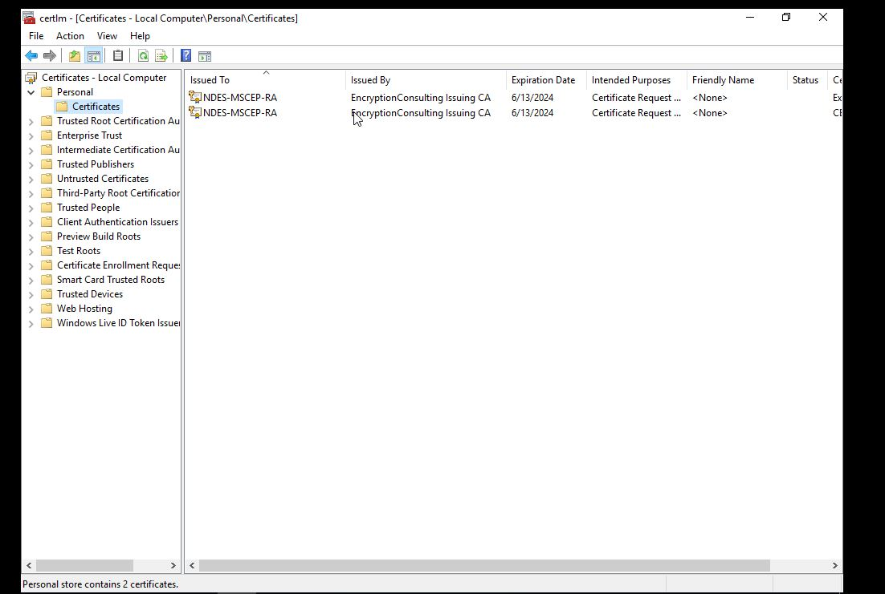

3. Locate the certificate that has **CEP Encryption** as the certificate template.

    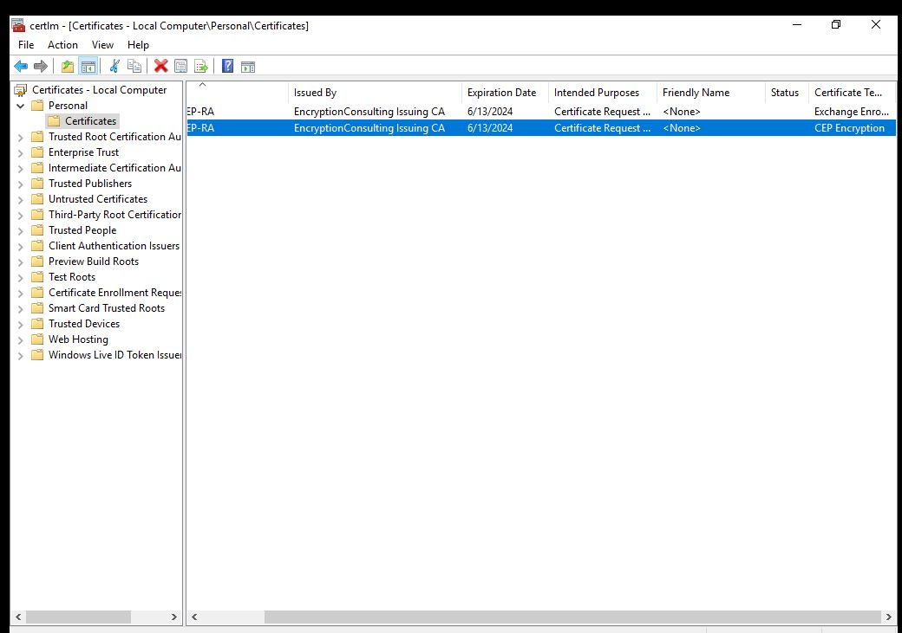

4. Right-click on the certificate and select **All Tasks > Renew Certificate with New Key**.

    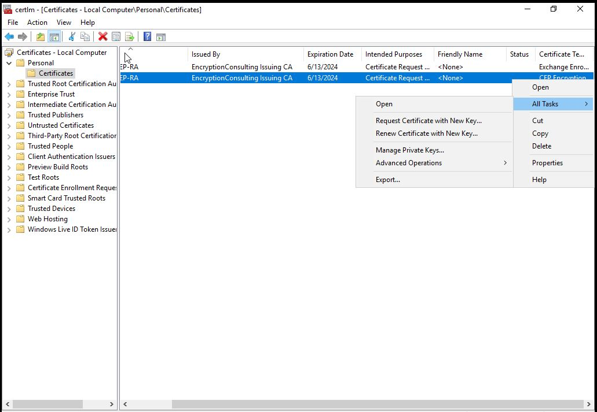

5. Click **Next** on the **Before you begin** page of the Certificate Enrollment wizard that appears.

    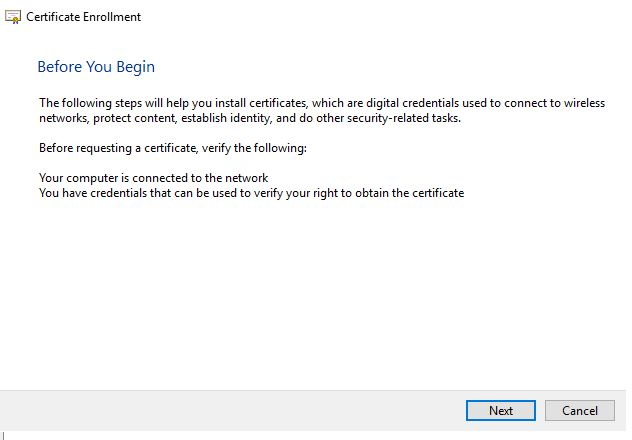

6. Click **Enroll**.

    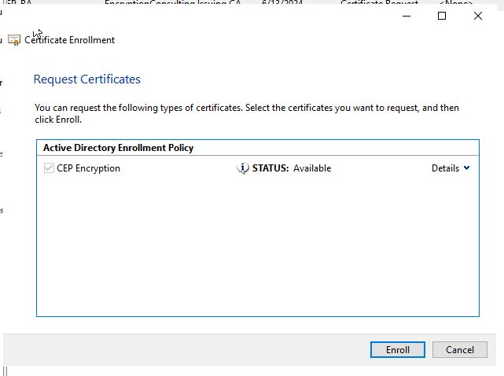

7. Click **Finish** when the certificate has successfully been enrolled.

    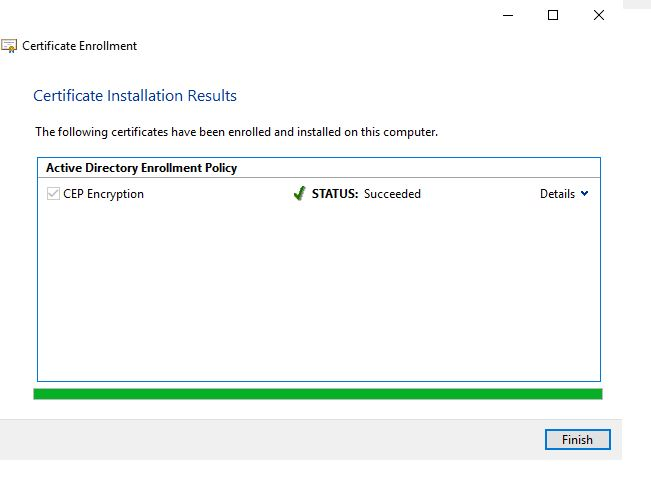

8. Configure the new certificate's private key so that the NDES service account can read it. Right-click the new certificate and select **All Tasks > Manage Private Keys**.

    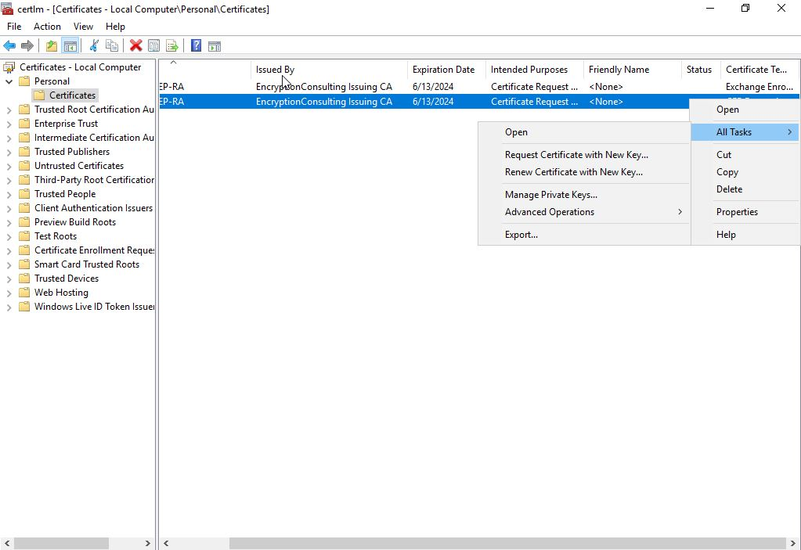

9. Click the **Add** button and browse for the service account used for NDES. Grant it **Read** permission only (not Full Control) and click **OK**.

    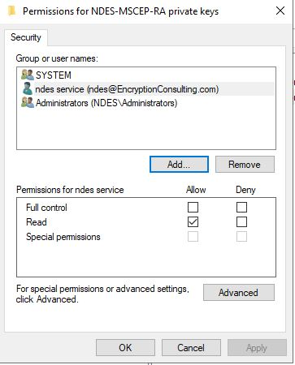

10. The Key Exchange certificate is now renewed. Complete [Final configuration before NDES is operational again](#final-configuration-before-ndes-is-operational-again) before you return NDES to service.
11. After you have verified NDES, delete the superseded CEP Encryption certificate from the Personal store and ask your PKI team to revoke it with the reason **Superseded**. RA certificates are high-value credentials and should not be left valid on the server.

### Renew a non-expired Enrollment Agent certificate

**Prerequisites:**

- Existing Enrollment Agent certificate has not yet expired.
- The user performing the renewal operation outlined below needs to have been given Read and Enroll permissions on the Exchange Enrollment Agent (Offline request) certificate template, or added to a group that has been given those permissions.
- The Exchange Enrollment Agent (Offline request) certificate template needs to be enabled (issued for use for certificate enrollment).
- You know the name of the NDES service account.
- You are signed in to the NDES server with local administrator rights, using a dedicated PKI administration account rather than a domain administrator account.

> **Note:** You can't use the Certificates console to renew the Enrollment Agent certificate. You can, however, use it to retrieve the thumbprint of the existing Enrollment Agent certificate, which this procedure requires.

**Steps:**

1. Open the local computer Certificates console by running `certlm.msc` as an administrator.
2. Expand **Personal** and then expand **Certificates**.

    

3. Locate the certificate that has the **Exchange Enrollment Agent (Offline request)** as the certificate template.

    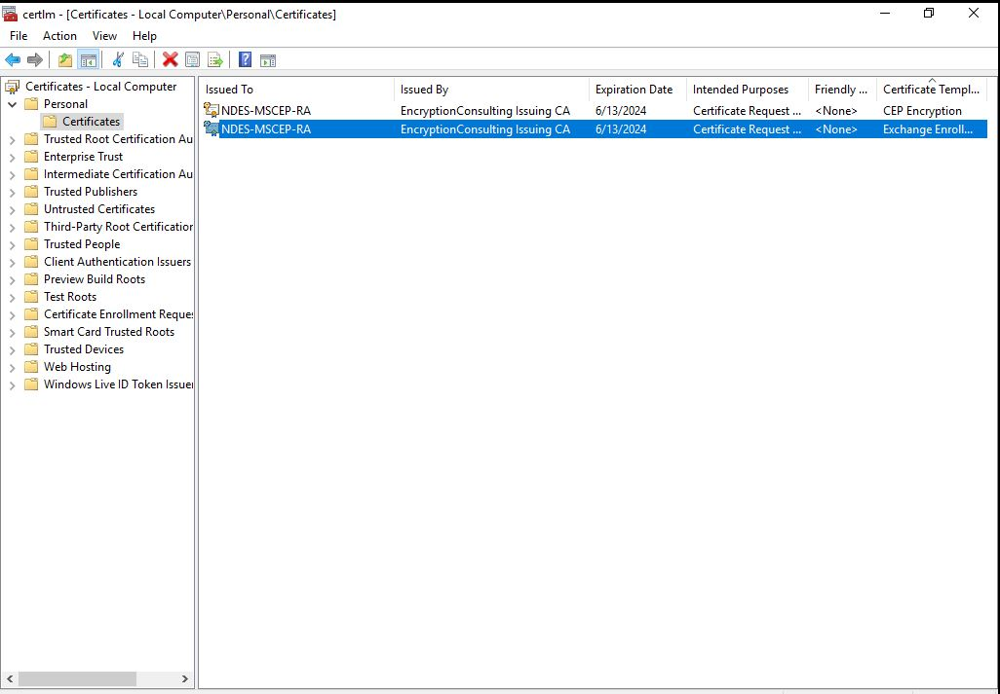

4. Double-click the certificate or right-click and select **Open**. Scroll down to the **Thumbprint** entry and select it in the **Details** tab. Copy the value; you will need it in the next steps.

    > **Important:** Copying the thumbprint from this dialog often adds an invisible character at the start of the value, which causes certreq.exe and PowerShell to fail without a clear error. To avoid this, retrieve the thumbprint from an elevated PowerShell console instead and copy it from there:
    >
    > ```powershell
    > Get-ChildItem -Path Cert:\LocalMachine\My | Format-List Subject, Thumbprint, NotAfter
    > ```

    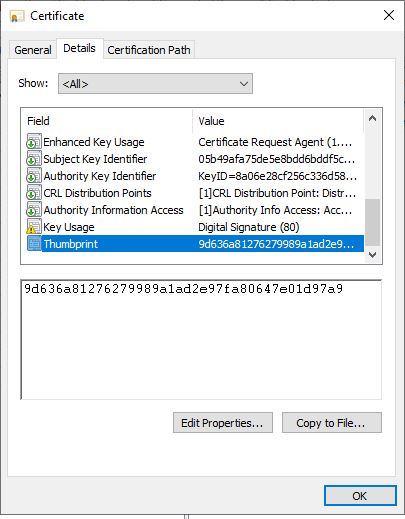

5. Create a new file named `EEARequest.inf` in, e.g., `C:\Certificates` on the NDES server. Open `EEARequest.inf` and paste the following content:

    ```ini
    [Version]
    Signature="$Windows NT$"

    [NewRequest]
    RenewalCert="<Certificate Hash Thumbprint>"
    MachineKeySet=TRUE
    ```

    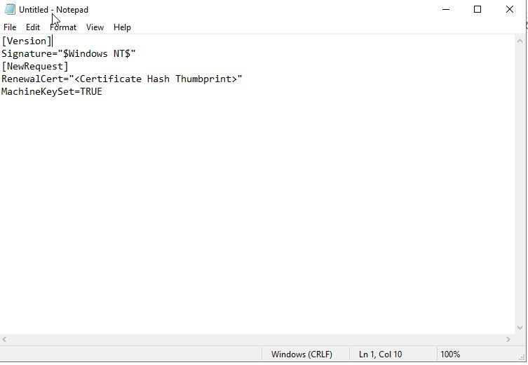

6. Before saving the file, replace the `<Certificate Hash Thumbprint>` value with the thumbprint value copied from the existing Enrollment Agent certificate earlier. This is how it should look:

    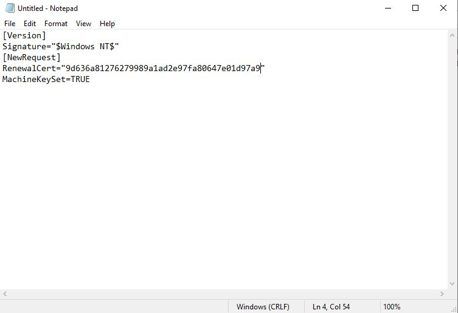

7. Save the file. From an elevated command prompt, browse to the directory where the `EEARequest.inf` file was saved and run the following command:

    ```bat
    certreq.exe -New EEARequest.inf EEACert.req
    ```

    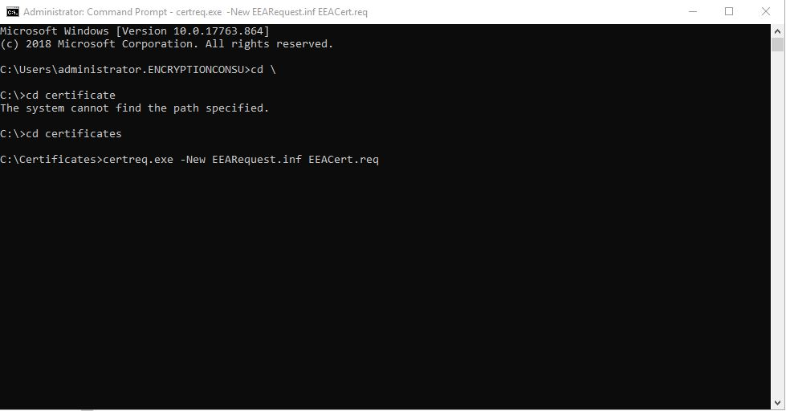

8. Click **OK** in the **Certificate List** window that appears, as it should contain the certificate details for the existing Enrollment Agent certificate. If you don't get the Certificate List window, go back and check that the correct thumbprint was copied and that it contains no hidden characters (see step 4).

    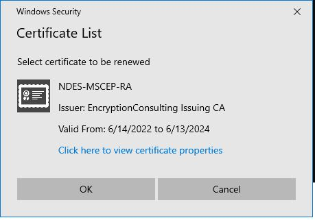

9. certreq.exe should output that the request was created and a new file named `EEACert.req` is created in the `C:\Certificates` folder.

    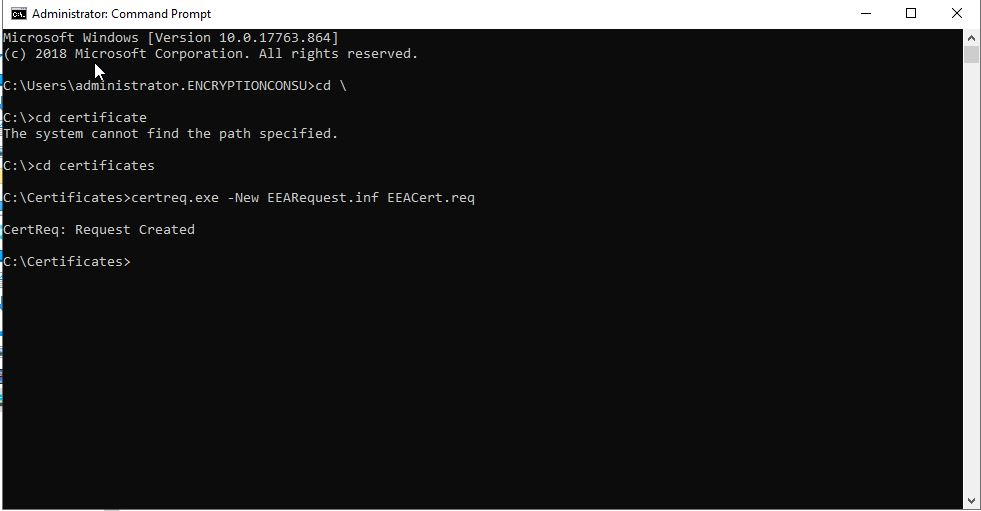

10. Run the following command to submit the certificate request to the Certification Authority (CA):

    ```bat
    certreq.exe -Submit EEACert.req EEACert.cer
    ```

    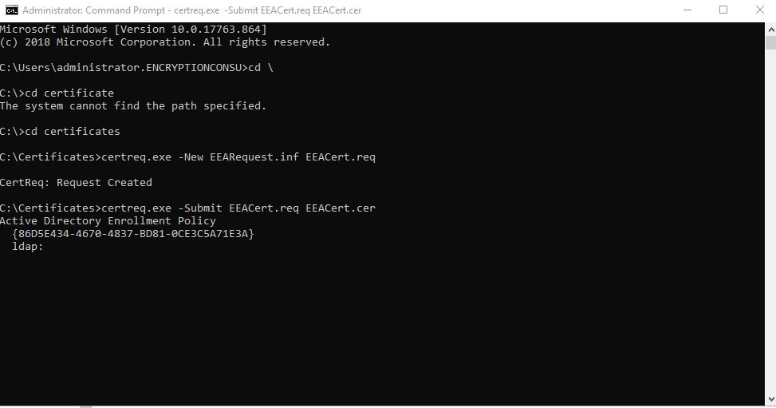

11. In the **Certification Authority List** window that appears, confirm that the correct CA is selected and click **OK**.

    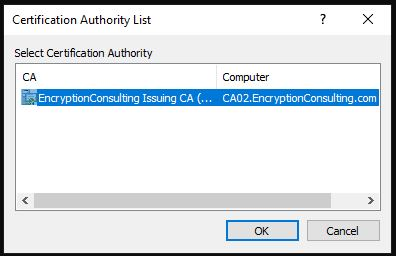

12. When the request is submitted successfully, certreq.exe reports that it has retrieved the certificate, and two new files named `EEACert.cer` and `EEACert.rsp` are created in the `C:\Certificates` folder.

    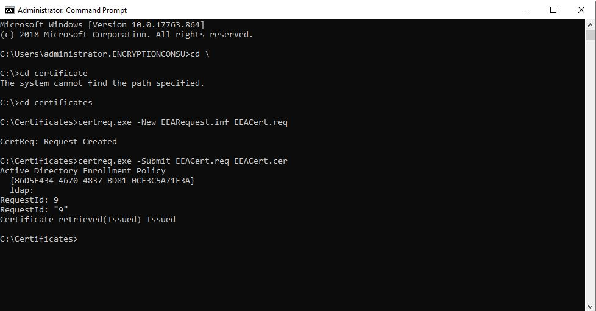

13. Run the following command to accept the newly issued certificate:

    ```bat
    certreq.exe -Accept EEACert.cer
    ```

    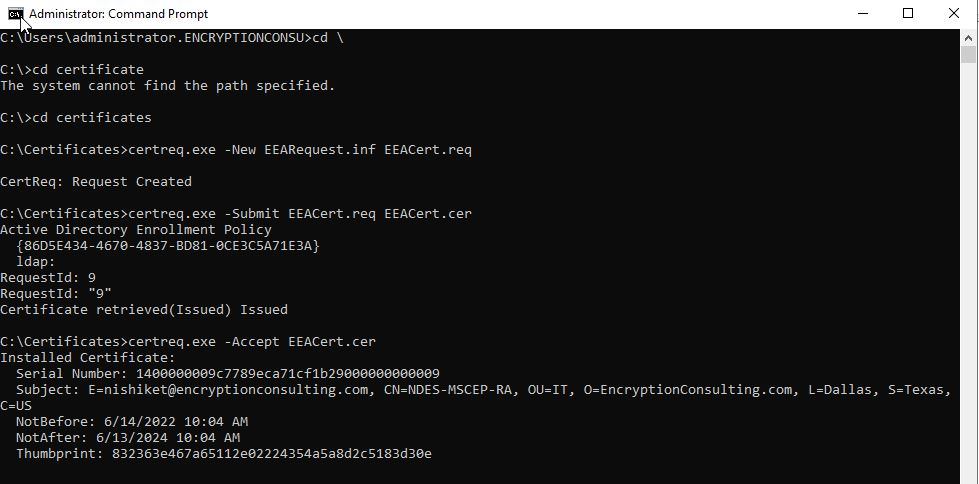

14. Configure the new certificate's private key so that the NDES service account can read it. In the Certificates console, right-click the new certificate and select **All Tasks > Manage Private Keys**.
15. Click the **Add** button and browse for the service account used for NDES. Grant it **Read** permission only (not Full Control) and click **OK**.
16. The Enrollment Agent certificate is now renewed and appears in the Certificates console alongside the previous certificate.
17. Delete the working files (`EEARequest.inf`, `EEACert.req`, `EEACert.cer` and `EEACert.rsp`) from `C:\Certificates`. They contain no private keys, but they are no longer needed.
18. Complete [Final configuration before NDES is operational again](#final-configuration-before-ndes-is-operational-again). After you have verified NDES, delete the superseded Enrollment Agent certificate from the Personal store and ask your PKI team to revoke it with the reason **Superseded**. An enrollment agent certificate can be used to request certificates on behalf of other users, so a superseded one should not be left valid.

## Renew expired NDES service certificates

### Renew an expired Key Exchange certificate

**Prerequisites:**

- Existing Key Exchange certificate has expired.
- The server running NDES needs to have been given Read and Enroll permissions on the CEP Encryption certificate template, or added to a group that has been given those same permissions.
- The CEP Encryption certificate template needs to be enabled (issued for use for certificate enrollment).
- You know the name of the NDES service account.
- You are signed in to the NDES server with local administrator rights, using a dedicated PKI administration account rather than a domain administrator account.

Renewing an expired Key Exchange certificate follows the same process as [Renew a non-expired Key Exchange certificate](#renew-a-non-expired-key-exchange-certificate), with one difference in step 4:

- Right-click the expired certificate and select **All Tasks > Request Certificate with New Key** (instead of Renew Certificate with New Key).

Then complete steps 5 to 11 of [Renew a non-expired Key Exchange certificate](#renew-a-non-expired-key-exchange-certificate), including granting the NDES service account Read access to the new private key.

### Renew an expired Enrollment Agent certificate

**Prerequisites:**

- Existing Enrollment Agent certificate has expired.
- The user performing the renewal operation outlined below needs to have been given Read and Enroll permissions on the Exchange Enrollment Agent (Offline request) certificate template, or added to a group that has been given those permissions.
- The Exchange Enrollment Agent (Offline request) certificate template needs to be enabled (issued for use for certificate enrollment).
- You know the name of the NDES service account.
- You are signed in to the NDES server with local administrator rights, using a dedicated PKI administration account rather than a domain administrator account.

> **Note:** In the screenshots for this section, the certificate shown had not yet expired; the procedure is the same for an expired certificate.

**Steps:**

1. Open the local computer Certificates console by running `certlm.msc` as an administrator.
2. Expand **Personal** and then expand **Certificates**.

    

3. Locate the certificate that has the **Exchange Enrollment Agent (Offline request)** as the certificate template.

    

4. Double-click the certificate or right-click and select **Open**. Scroll down to the **Thumbprint** entry and select it in the **Details** tab. Copy the value; you will need it in the next step.

    > **Important:** Copying the thumbprint from this dialog often adds an invisible character at the start of the value, which causes certreq.exe and PowerShell to fail without a clear error. To avoid this, retrieve the thumbprint from an elevated PowerShell console instead and copy it from there:
    >
    > ```powershell
    > Get-ChildItem -Path Cert:\LocalMachine\My | Format-List Subject, Thumbprint, NotAfter
    > ```

    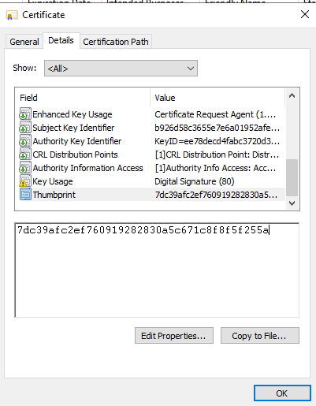

5. Start an elevated PowerShell console and run the following command, replacing `<THUMBPRINT>` with the thumbprint you copied. The command displays the full subject of the certificate.

    ```powershell
    Get-ChildItem -Path Cert:\LocalMachine\My\<THUMBPRINT> | Select-Object -ExpandProperty Subject
    ```

    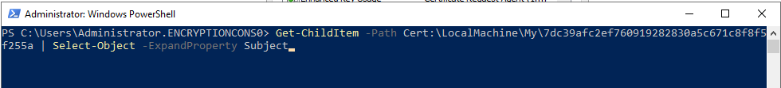

6. Copy the full subject string from the output (for example, `CN=NDES-MSCEP-RA, C=US`). You will need it in step 8.

    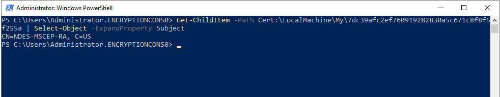

7. Create a new file named `EEARequest.inf` in, e.g., `C:\Certificates` on the NDES server. Open `EEARequest.inf` and paste the following content:

    ```ini
    [Version]
    Signature="$Windows NT$"

    [NewRequest]
    Subject = "<INSERT SUBJECT HERE>"
    Exportable = TRUE
    KeyLength = 2048
    KeySpec = 2
    KeyUsage = 0x80
    MachineKeySet = TRUE
    ProviderName = "Microsoft Enhanced Cryptographic Provider v1.0"
    ProviderType = 1

    [EnhancedKeyUsageExtension]
    OID = 1.3.6.1.4.1.311.20.2.1

    [RequestAttributes]
    CertificateTemplate = EnrollmentAgentOffline
    ```

    > **Note:** Keep `ProviderName` and `ProviderType` as shown. NDES requires its RA certificates to use a legacy CryptoAPI provider; a CNG key storage provider prevents NDES from using the certificate.

    `Exportable` is set to `TRUE` so that you can back up the certificate and its private key. If your organization does not need a backup of this key, set `Exportable = FALSE` before saving the file. This is the more secure option, because the private key can then never leave the server. You cannot change this setting after the certificate is issued; you would need to request a new certificate.

8. On the `Subject` line, replace `<INSERT SUBJECT HERE>` with the subject string you copied in step 6, and then save `EEARequest.inf`.

    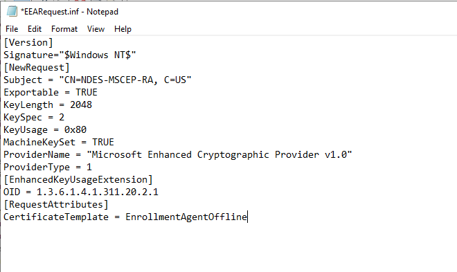

9. Open an elevated command prompt, browse to the `C:\Certificates` folder, and run the following:

    ```bat
    certutil
    ```

    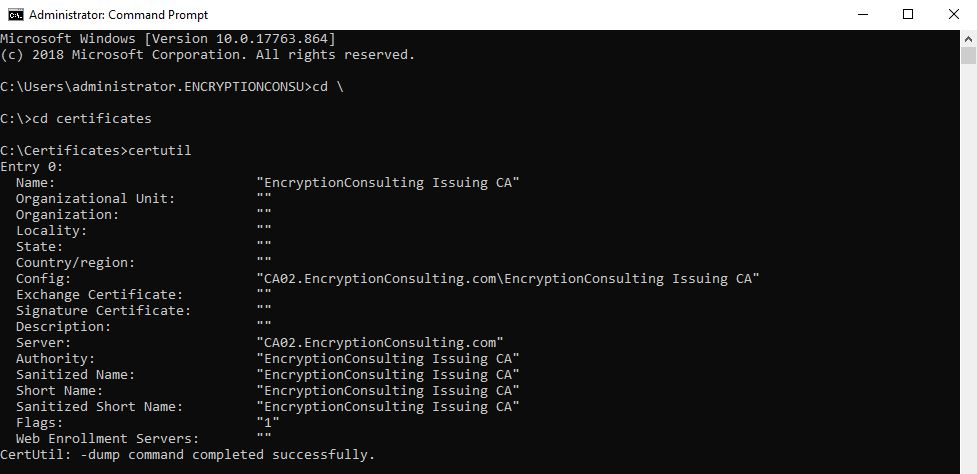

10. From the output of the previous command, copy the value next to the **Config** entry; you will use it in step 13.
11. Run the following command:

    ```bat
    certreq.exe -f -new EEARequest.inf EEARequest.req
    ```

    A Certificate Request Processor warning states "Machine context template conflicts with user context". This is expected, because EnrollmentAgentOffline is a user template being requested into the computer store. Click **OK**; the request is still created.

    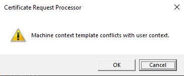

12. A new file named `EEARequest.req` is created in `C:\Certificates` once the command has successfully completed.

    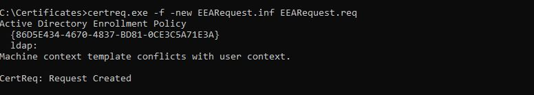

13. Run the following command to submit the certificate request to the CA, replacing `<Config value>` with the value you copied in step 10:

    ```bat
    certreq.exe -submit -config "<Config value>" EEARequest.req EEARequest.cer
    ```

    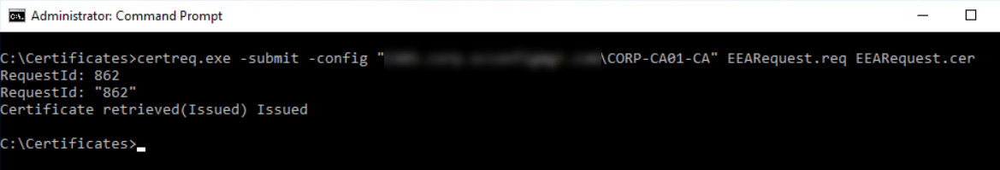

14. Run the following command to accept the newly issued `EEARequest.cer` certificate into the computer certificate store on the NDES server.

    ```bat
    certreq.exe -accept EEARequest.cer
    ```

    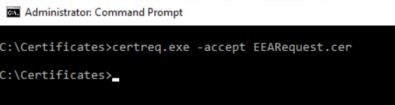

15. Grant the NDES service account access to the new private key. In the Certificates console, right-click the new Enrollment Agent certificate and select **All Tasks > Manage Private Keys**.
16. Click **Add**, select the NDES service account, grant it **Read** permission only (not Full Control), and click **OK**. NDES cannot use the new certificate until you complete this step.
17. The Enrollment Agent certificate is now renewed. In the Certificates console, the new Enrollment Agent certificate appears alongside the expired one. After you complete the final configuration and verify NDES, delete the expired certificate from the Personal store.
18. Delete the working files (`EEARequest.inf`, `EEARequest.req`, `EEARequest.cer` and `EEARequest.rsp`) from `C:\Certificates`.

## Final configuration before NDES is operational again

After you renew either NDES certificate, open an elevated command prompt on the NDES server and run the following command to restart IIS so that NDES loads the new certificates:

```bat
iisreset
```

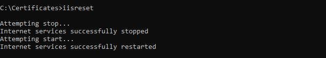

**Verify that NDES is working before you close the change:**

- On the NDES server, browse to `http://localhost/certsrv/mscep/mscep.dll?operation=GetCACert&message=NDES`. Save the downloaded file with a `.p7b` extension, open it, and confirm that it contains the new RA certificates with the new expiry dates.
- Perform one test SCEP enrollment from a managed device or network device and confirm that a certificate is issued.
- If you use Microsoft Intune, confirm that the Certificate Connector shows as active in the Intune admin center.
- Remove the superseded RA certificates as described in the renewal steps, and set expiry alerts at 60 and 30 days for the new certificates.

## Troubleshooting

### Viewing logs

To open the log:

1. On the affected Windows device, run `eventvwr.msc` to open Windows Event Viewer. You can also open it from **Start > Windows Tools > Event Viewer**.

    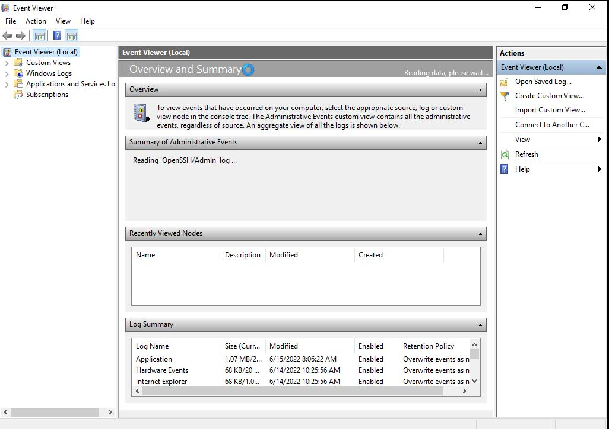

2. Expand **Applications and Services Logs > Microsoft > Windows > DeviceManagement-Enterprise-Diagnostics-Provider > Admin**.

    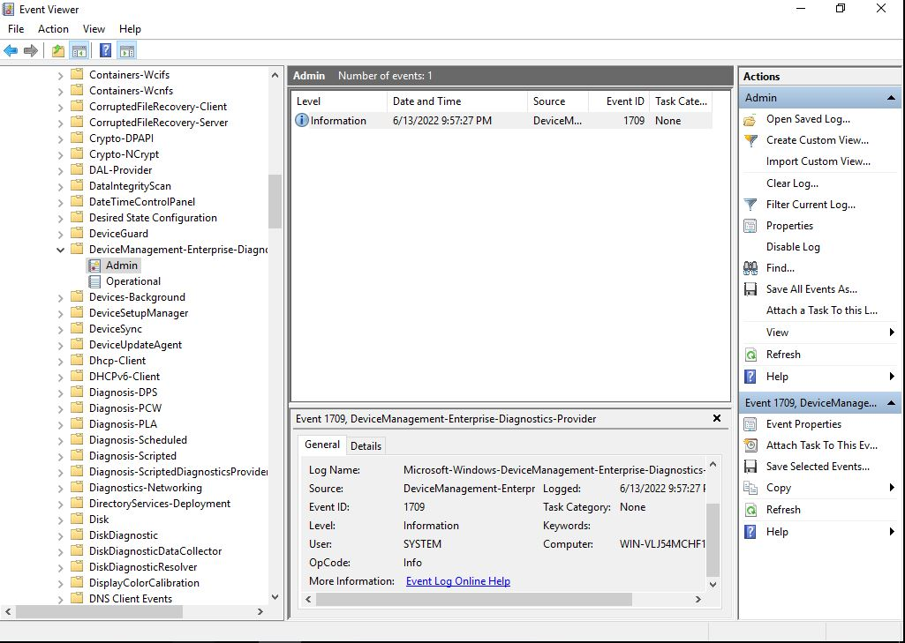

This log shows MDM and SCEP enrollment events from the device's side.

> **Note:** These are client-side logs. For errors on the NDES server itself, check **Windows Logs > Application** on the NDES server and filter on NDES-related sources such as NetworkDeviceEnrollmentService. If you use the Intune Certificate Connector, also check **Applications and Services Logs > Microsoft > Intune > CertificateConnectors** on the connector server.

### Errors related to the NDES service account

The NDES service account needs only the following: membership in the local IIS_IUSRS group on the NDES server, Request Certificates permission on the CA, and Read and Enroll permissions on the certificate templates that NDES uses. It must not be a member of Domain Admins or any other privileged group. Administrative rights do not fix NDES errors, and they expose the whole domain if the internet-facing NDES server is compromised.

1. In Server Manager, select **Tools > Active Directory Users and Computers**.
2. Locate the NDES service account.

    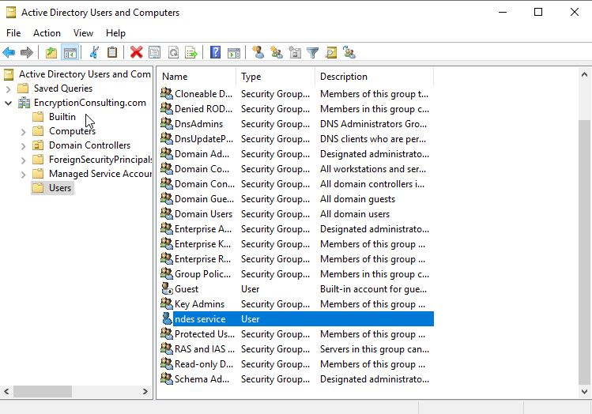

3. Open the account's **Properties** and select the **Member Of** tab.

    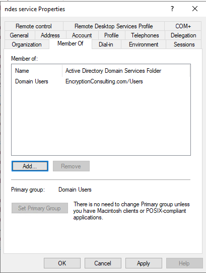

4. Confirm that the account is a member of Domain Users only, and remove it from Domain Admins or any other privileged group. Then, on the NDES server, run `lusrmgr.msc`, open **Groups > IIS_IUSRS**, and confirm that the service account is a member; add it if it is not. The Builtin\IIS_IUSRS group shown in Active Directory Users and Computers is a different group and does not meet this requirement. After changing the membership, run `iisreset` on the NDES server so that the NDES application pool picks up the change.

    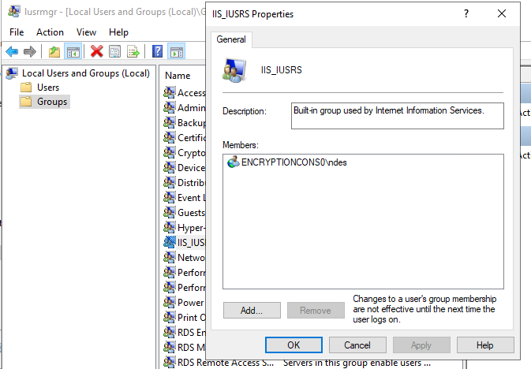

### Enroll option unavailable when renewing certificates (check on the CA server)

1. Open the Certification Authority console (`certsrv.msc`) and select **Certificate Templates**.

    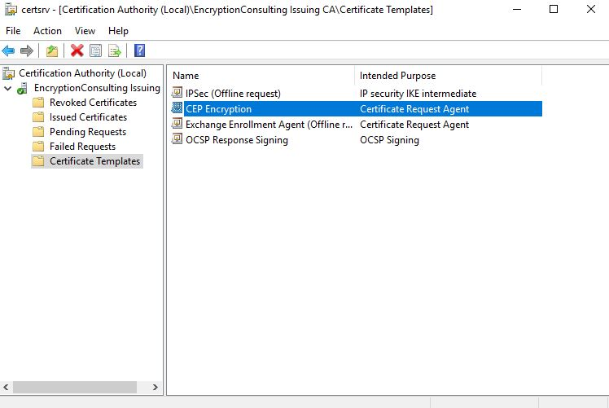

2. Confirm that the **CEP Encryption** and **Exchange Enrollment Agent (Offline request)** templates are listed. If they are not, right-click **Certificate Templates**, select **New > Certificate Template to Issue**, and add them.

    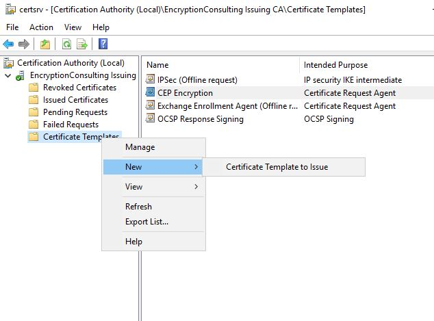

3. If they are listed, right-click **Certificate Templates** and select **Manage** to open the Certificate Templates console.

    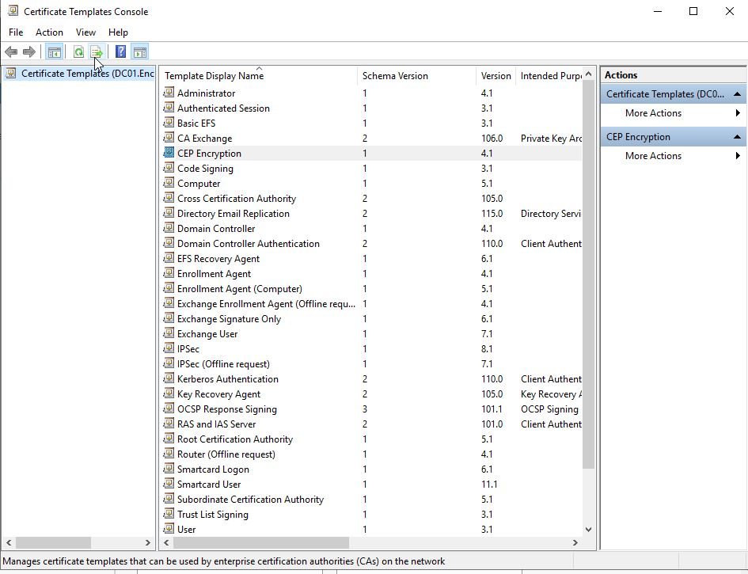

4. Right-click the template you are enrolling for (CEP Encryption or Exchange Enrollment Agent (Offline request)) and select **Properties**.

    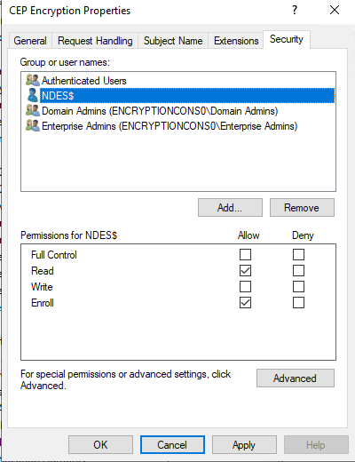

5. On the **Security** tab, confirm that the account performing the enrollment has **Read** and **Enroll**: the NDES server's computer account for CEP Encryption, and the PKI administration account or group for Exchange Enrollment Agent (Offline request). Grant only Read and Enroll.

> **Warning:** Do not grant Write or Full Control to Authenticated Users, Domain Users or the NDES service account, and remove these permissions if they are present. Write access to a certificate template lets the holder reconfigure it to issue certificates that can be used to take over the domain. Because both templates issue enrollment agent certificates, do not grant Enroll to Authenticated Users or Domain Users either.

## Related articles

- [certutil Command Reference for AD CS and HSM Operations](certutil-command-reference.md)
- [Enrolling Certificates with PKIaaS: ACME, SCEP, and Intune](../../01-Products/PKI-as-a-Service/enrolling-certificates-with-pkiaas-acme-scep-intune.md)
